# Fluxo 5 — Cura Mediúnica / Bioenergético (`/bio`)

Tratamento em que o paciente percorre uma **rota de etapas**, em vez de uma fila única. É independente das
filas dos fluxos 1 a 4: tem telas, estado e arquivo diário próprios. O processo oficial, passo a passo, está em
[Fluxo operacional dos tratamentos bioenergéticos](fluxo-operacional-bio.md).

| Tela | Endereço | Quem usa |
|---|---|---|
| Recepção | `/bio/recepcao` | A recepção: cadastra os pacientes e orienta onde aguardar |
| Controle | `/bio/controle` | O responsável pelo controle e pela orquestração: abre o dia, chama, conclui, cuida do prontuário e fecha o dia |
| Painel da TV | `/bio/painel` | As duas TVs (térreo e 1º andar), com a mesma tela |

Resumo para consulta rápida no [guia da Cura Mediúnica](../guias/bio.md).

## A rota e as salas

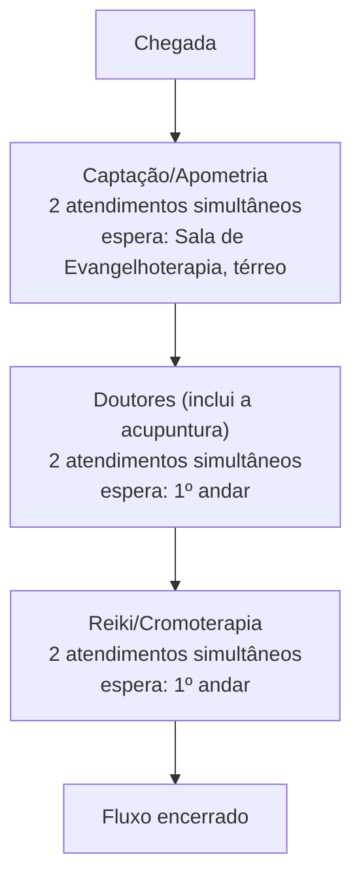

Etapas, salas, capacidades e locais de espera ficam em `config/bio.json`. A **Acupuntura** faz parte do atendimento dos
**Doutores**: não é uma etapa nem uma sala separada. Para mudar o fluxo, edite o arquivo e reinicie o servidor; no dia a dia,
vagas e salas se ajustam na própria tela.

## Passo a passo

### 1. Abertura dos trabalhos (controle)
Com o dia fechado, o controle mostra a **Abertura dos trabalhos**:

- marque as **salas que funcionam hoje** e a **capacidade** de cada uma (ex.: número de macas do reiki);
- em **sala/local**, informe **com antecedência onde cada tratamento acontece hoje** (ex.: *Sala 03 (térreo)*). Esse local **já vem preenchido para o paciente quando ele é chamado** para aquela sala, e dá para mudar depois. O navegador lembra os locais usados na última abertura;
- se houver lista de pré-inscritos, cole **uma pessoa por linha**: `Nome Sobrenome ; dia ; descrição`;
- o **relatório do último dia fechado** aparece embaixo, como referência.

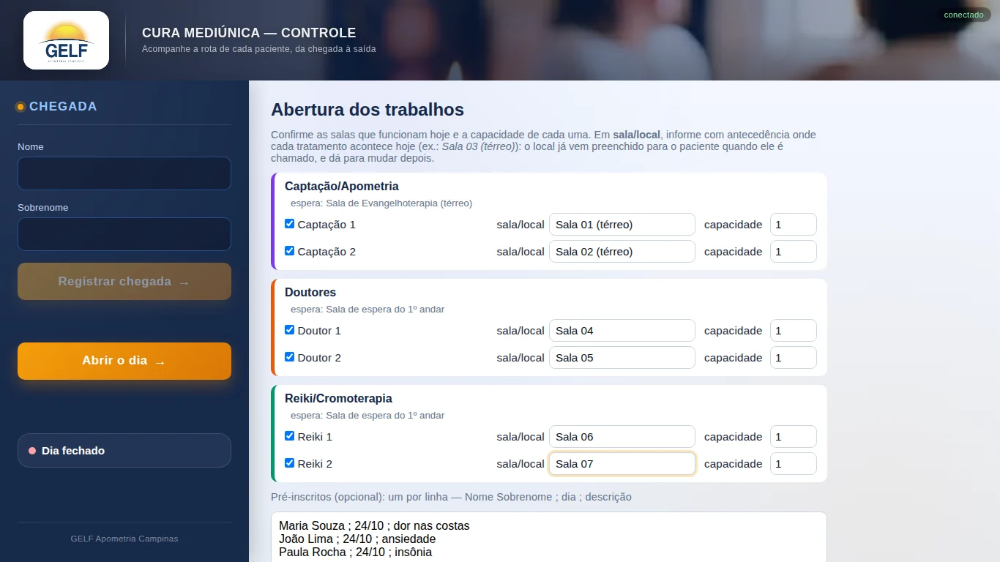

Toque em **Abrir o dia**, no menu da esquerda, logo abaixo de **Registrar chegada**. O indicador passa a **Dia aberto** e as colunas de cada etapa aparecem.
Na TV, o painel muda de **Atendimento encerrado** para **Aguardando próxima chamada**.

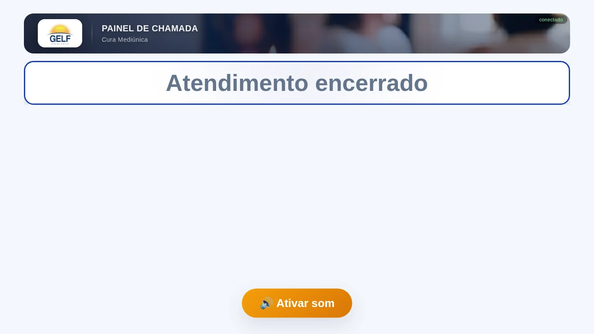

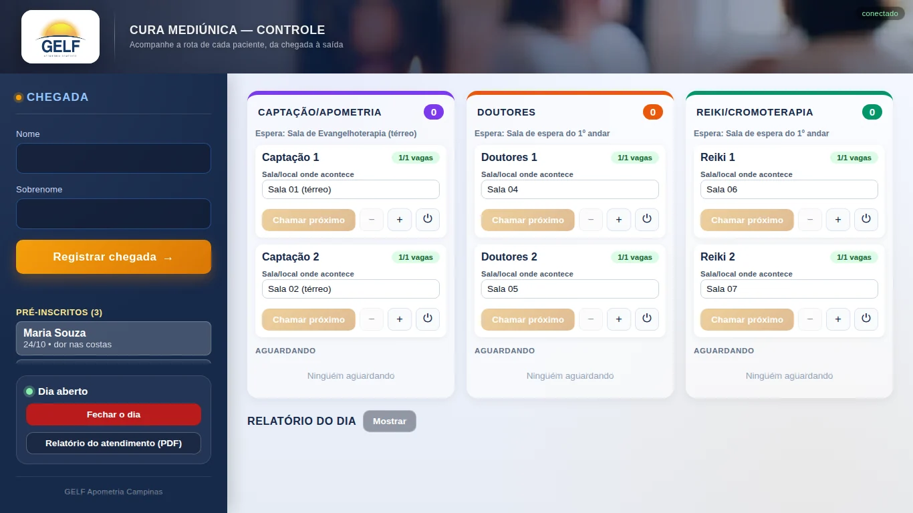

### 2. Cadastro pela recepção
Em `/bio/recepcao`, a recepção cadastra **todos** os pacientes do dia. Com o dia ainda fechado, o botão
**Cadastrar** fica desativado e a tela avisa que o controle abre o dia.

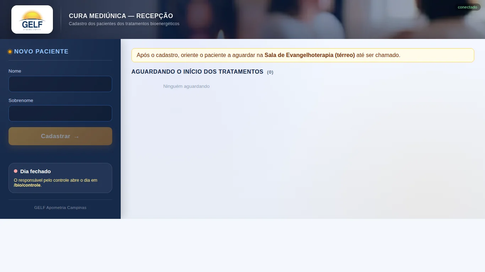

Duas formas de cadastrar, ambas colocam o paciente no **fim da espera da primeira etapa**:

- digitar **Nome e Sobrenome** e tocar em **Cadastrar**;
- tocar no nome na lista **Pré-inscritos** (o paciente leva a descrição junto, ex.: "dor nas costas").

A cada cadastro, a tela diz o que fazer: **"Orientar: aguardar na Sala de Evangelhoterapia (térreo)"**.
Cada cartão tem ★ (prioridade), ✎ (corrigir o nome) e ✕ (remover, com confirmação).

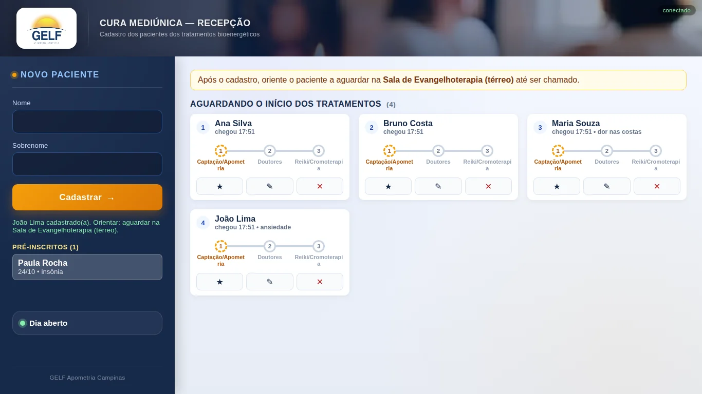

Se o nome já existe no fluxo, aparece **"Já existe um paciente com este nome no fluxo"**: **Cadastrar mesmo
assim** (é outra pessoa) ou **Cancelar** (limpa os campos).

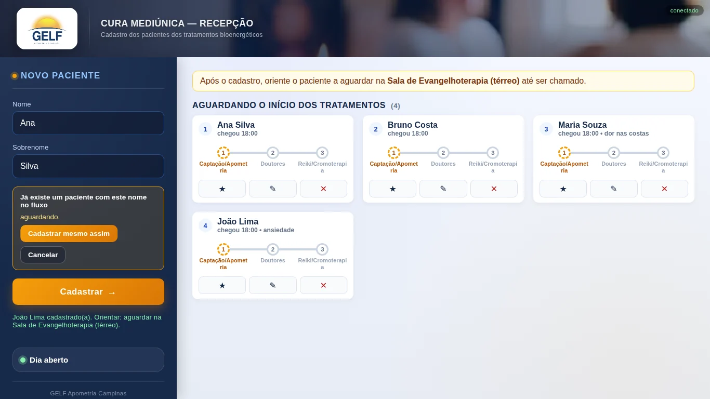

**Prioridade ★** (idosos, gestantes, pessoas com deficiência): toque na ★ do cartão. O paciente **sobe para o início da
fila**, o cartão fica destacado e aparece o selo **prioridade**. Com mais de um prioritário, vale a ordem em que foram
marcados. A prioridade **acompanha o paciente por toda a jornada**: ele passa na frente em cada espera seguinte. Toque de
novo na ★ para retirar. O mesmo botão existe no cartão do paciente no controle.

**Aviso do prioritário:** ao marcar, a tela mostra (e o cartão mantém) o lembrete: *"Prioritário: os tratamentos devem ser feitos
em uma sala do térreo e, entre os atendimentos, o paciente aguarda na Sala de Evangelhoterapia (térreo) até ser chamado."* O mesmo
lembrete aparece no cartão do controle e, quando o prioritário conclui uma etapa, a **TV** diz *"aguarde: Sala de Evangelhoterapia
(térreo)"* (os demais pacientes aguardam na sala de espera do 1º andar).

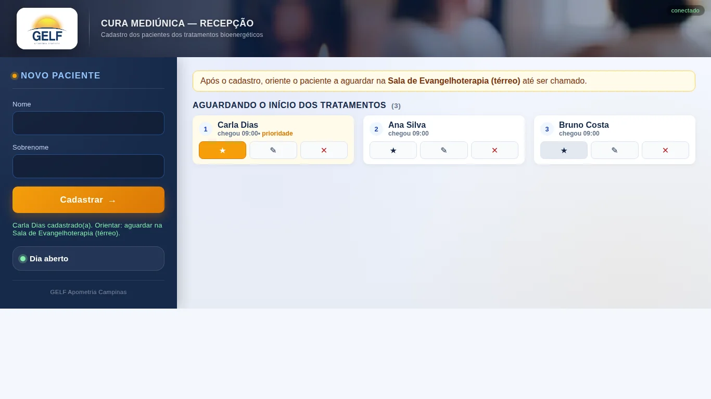

**Barra de progresso por etapas (recepção).** Cada cartão de paciente na recepção mostra uma barra com uma bolinha por etapa do
dia dele: **verde com ✓** = concluída; **cor da etapa e preenchida** = em atendimento; **contorno pulsando** = chamado; **tracejada em
âmbar** = aguardando a etapa; **cinza** = ainda por fazer. Assim a recepção vê onde cada paciente está, sem precisar do controle.
A TV **não** mostra essa barra.

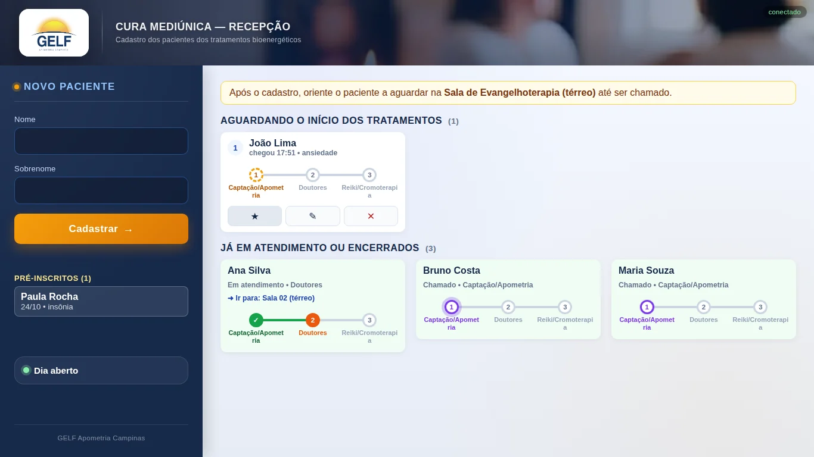

**Sala para onde ir:** quando o controle informa a sala do paciente (item 3), a recepção vê no cartão **"➜ Ir para: Sala X"**, para orientar o paciente.

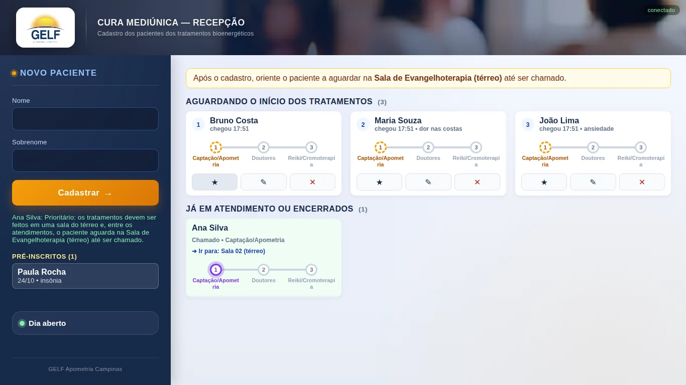

### 3. Conferir as filas e chamar (controle)
O controle vê as filas já com todos os cadastrados.

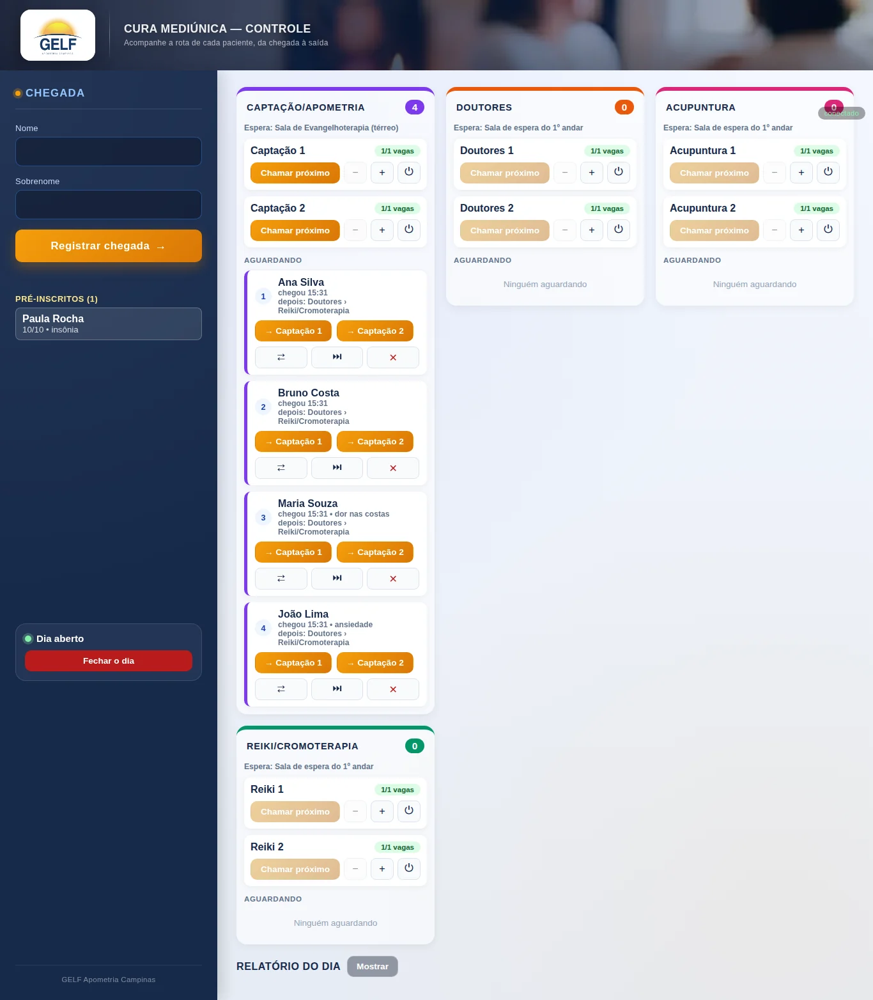

No controle, o prioritário aparece primeiro na fila, com o selo **prioridade**, e **Chamar próximo** chama quem está no topo.

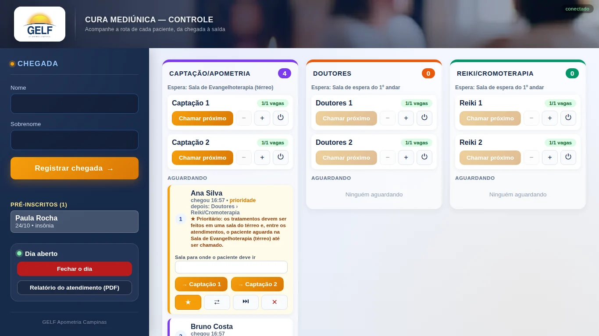

Cada coluna tem as suas **duas salas** (ex.: Captação 1 e Captação 2, ou Doutor 1 e Doutor 2), com as vagas (ex.: `1/1 vagas`), e a lista **Aguardando**. Assim, **cada etapa atende 2 pacientes ao mesmo tempo**. Duas formas de chamar:

| Forma | Quando usar |
|---|---|
| **Chamar próximo** (na sala) | chama o primeiro da espera da etapa |
| **→ nome da sala** (no cartão do paciente) | os doutores escolhem **quem** entra |

Só chama se a sala tem vaga: sem vaga, o botão fica desativado. A chamada aparece na TV com som.

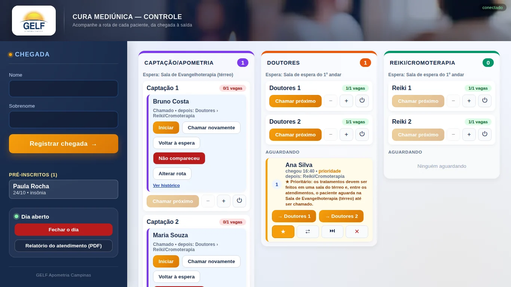

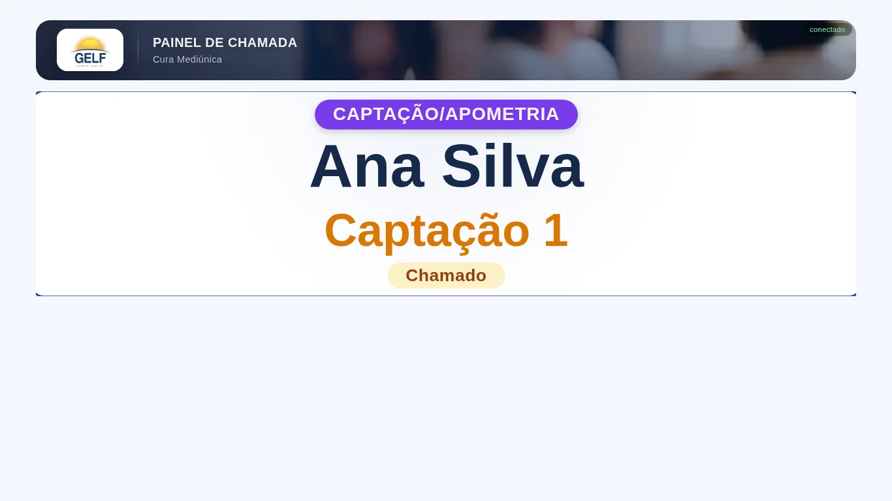

**Sala/local de cada tratamento.** Cada sala tem um campo **"Sala/local onde acontece"**: o que foi informado na abertura do dia aparece
ali e pode ser alterado a qualquer momento. Se o local mudar, quem está naquela sala com o local antigo passa a ver o novo (o que foi
digitado à mão para um paciente fica como está). Ao concluir a etapa, a sala de destino do paciente é limpa, e a da próxima etapa vem
preenchida quando ele for chamado.

**Informar a sala de destino.** Todo cartão de paciente (na espera ou na sala) tem o campo **"Sala para onde o paciente deve ir"**.
Ele **já vem preenchido com o local da sala chamada** (informado na abertura do dia); para um caso especial, como um prioritário, digite outra sala (por exemplo, *Sala 02 (térreo)*) e aperte **Enter** (ou saia do campo): ela aparece na hora no cartão do controle, na
recepção e na **TV**, no lugar do nome da sala chamada. Para prioritários, o campo sugere uma sala do térreo. Apagar o texto volta a
valer o nome da sala da chamada.

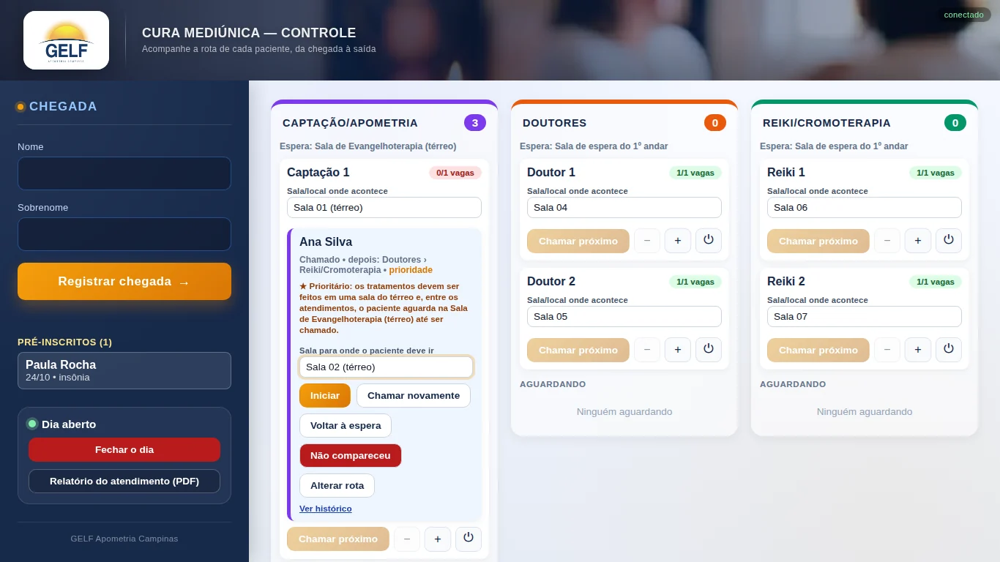

### 4. Acompanhar o paciente
Paciente **Chamado** (a caminho):

| Botão | O que faz |
|---|---|
| **Iniciar** | chegou à sala |
| **Chamar novamente** | repete aviso e som na TV |
| **Voltar à espera** | devolve ao fim da fila da mesma etapa |
| **Não compareceu** | encerra o paciente (veja o item 8) |

Paciente **Em atendimento**: **Concluir etapa** libera a vaga e leva o paciente à espera da **próxima etapa da
rota** (o cartão mostra "depois: Doutores › Reiki/Cromoterapia").

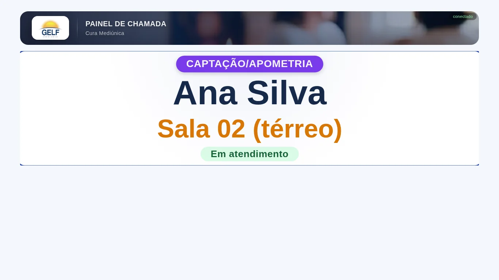

**A TV orienta o paciente.** Ao concluir uma etapa, o destaque passa a dizer onde aguardar:
**"Etapa concluída — aguarde: Sala de espera do 1º andar"**.

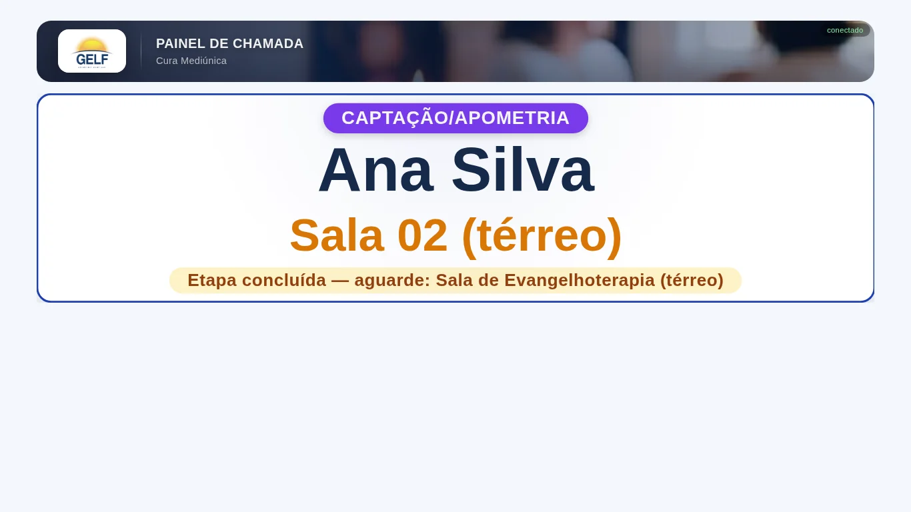

**Sem "sala pronta":** ao concluir a etapa, a vaga da sala volta na hora, e o controle já pode chamar o próximo.

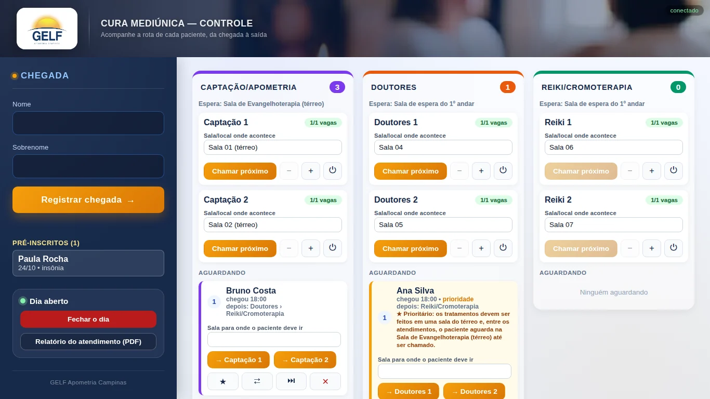

### 5. Doutores: prontuário (e acupuntura, quando indicada)
A **acupuntura**, quando os doutores a indicam, é feita **dentro do atendimento dos Doutores**: não há chamada, sala nem espera
separadas. No cartão do paciente na sala dos **Doutores** há um botão específico:

| Botão | O que faz |
|---|---|
| **Prontuário recebido** | marca que o controle recebeu o prontuário do tratamento pedido; o cartão passa a mostrar "📋 Prontuário com o paciente" |

O **Ver histórico** de cada cartão registra cada movimento, inclusive "Prontuário recebido".

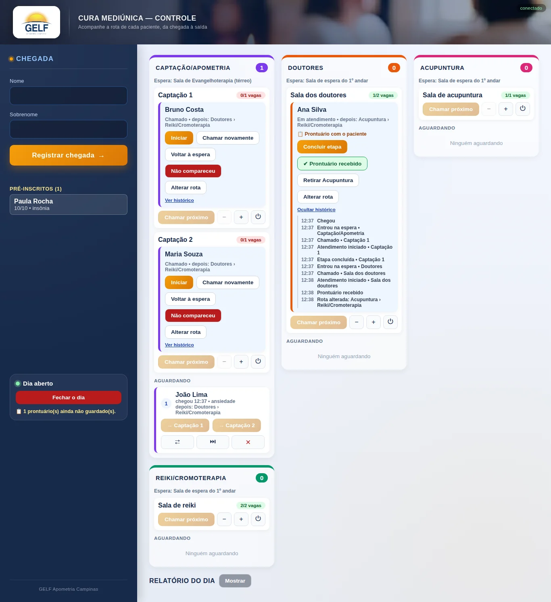

Nas etapas seguintes, o cartão da sala lembra que **o paciente deve entregar o prontuário** na sala.

### 6. Reiki/Cromoterapia: guardar o prontuário e encerrar
Na última etapa, o botão vira **Concluir e guardar prontuário**: conclui a etapa e registra que o controle
recolheu e guardou o prontuário. Ao concluir, o fluxo do paciente fica **encerrado no dia**.

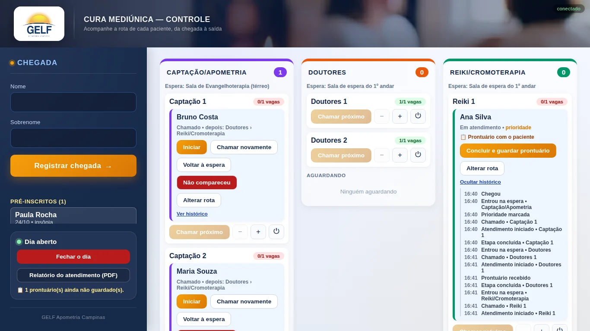

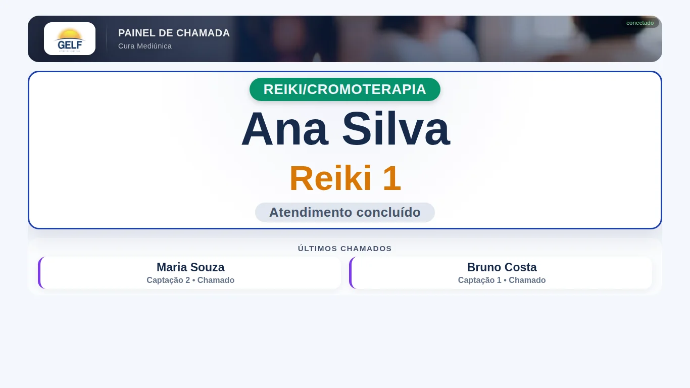

Se algum prontuário recebido não foi guardado, o controle mostra "📋 N prontuário(s) ainda não guardado(s)" ao lado
do botão de fechar o dia. Quem já saiu do fluxo (por exemplo, teve a última etapa pulada) aparece em **Finalizados hoje** com o
botão **Prontuário guardado**, que resolve a pendência.

### 7. Rota por paciente
No cartão de quem aguarda:

| Botão | O que faz |
|---|---|
| **⇄ Alterar rota** | toque nas etapas que faltam e em **Salvar rota**; as etapas ficam sempre **na ordem do fluxo** |
| **⏭ Pular esta etapa** | segue direto para a próxima |
| **✕ Remover do fluxo** | tira o paciente do fluxo |

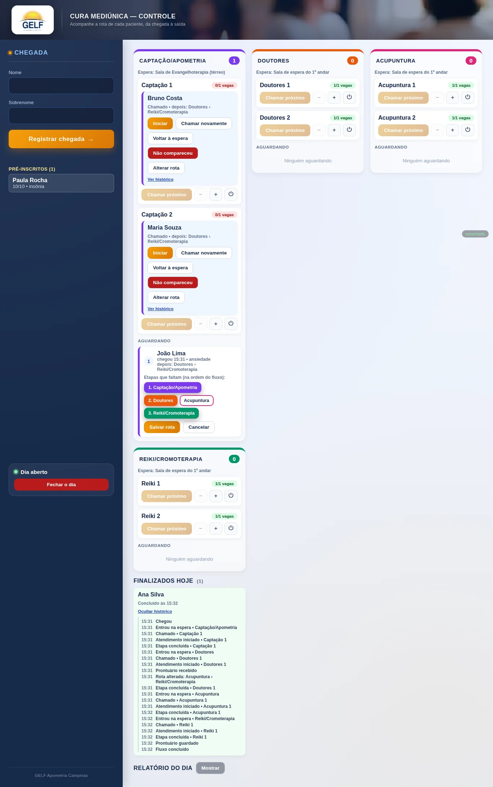

### 8. Não compareceu e voltar à espera
**Não compareceu** encerra o paciente: ele sai da TV e vai para **Finalizados hoje**. Se chegar atrasado,
**Voltar à espera** nesse cartão o devolve ao fim da fila da mesma etapa.

### 9. Ajustes durante o dia
Em cada sala: **−** / **+** tiram ou acrescentam uma vaga (macas); **⏻ / ▶** tira a sala de uso ou a recoloca
("fora de uso"). Uma sala ocupada não pode ser desativada.

### 10. Relatório do atendimento (PDF)
O botão **Relatório do atendimento (PDF)**, no menu da esquerda (abaixo de **Fechar o dia**), abre o relatório completo em
`/bio/relatorio`. Ele traz:

- **Resumo geral:** pacientes atendidos, fluxos concluídos, em andamento, não compareceram, prioritários, tempo médio total e, por
  etapa, atendidos, espera média, duração média e quem aguarda agora;
- **Registro por paciente:** nome, se é prioritário, chegada, situação e tempo total, e cada passagem por etapa com **sala,
  entrada na espera, início, fim, duração e situação**; prontuário (guardado ou não).

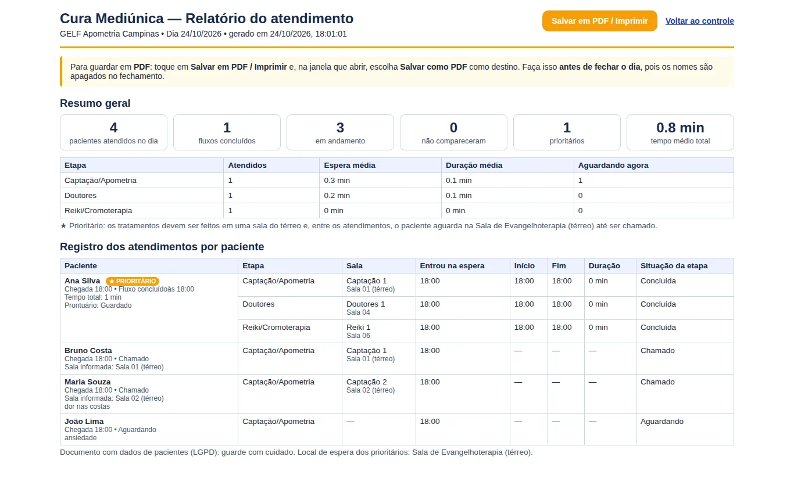

**Para salvar em PDF:** toque em **Salvar em PDF / Imprimir** e, na janela que abrir, escolha **Salvar como PDF** como destino. Faça
isso **antes de fechar o dia**: o relatório tem nomes, que são apagados no fechamento.

Há também o resumo rápido sem nomes, em **Relatório do dia → Mostrar**, na parte de baixo do controle. Quem é removido do fluxo
não conta como chegada.

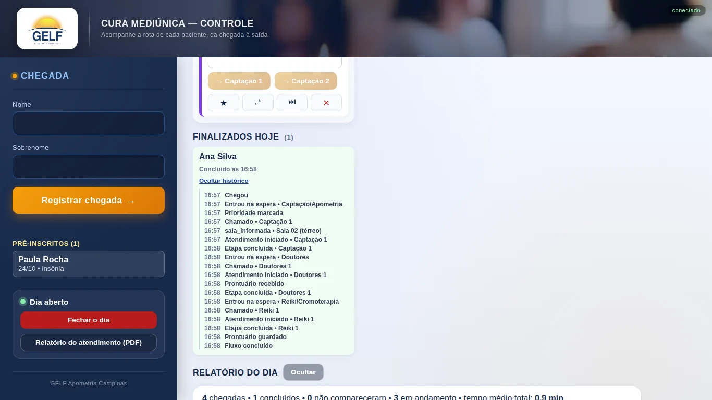

### 11. Fechar o dia
**Antes, salve o relatório completo em PDF** (item 10). Toque em **Fechar o dia** e confirme em **Confirmar: apagar tudo**. Isso apaga pacientes e pré-inscritos; só o
relatório, **sem nomes**, fica salvo em `dados/relatorios/bio-AAAA-MM-DD.json`. O painel da TV volta a
**Atendimento encerrado**.

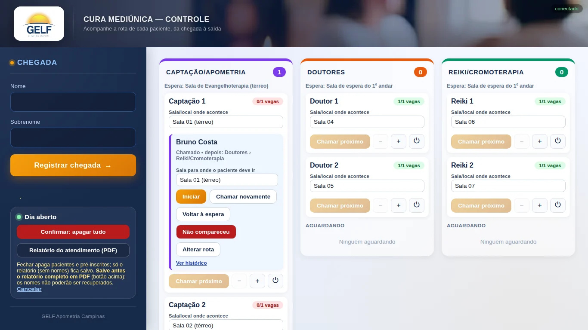

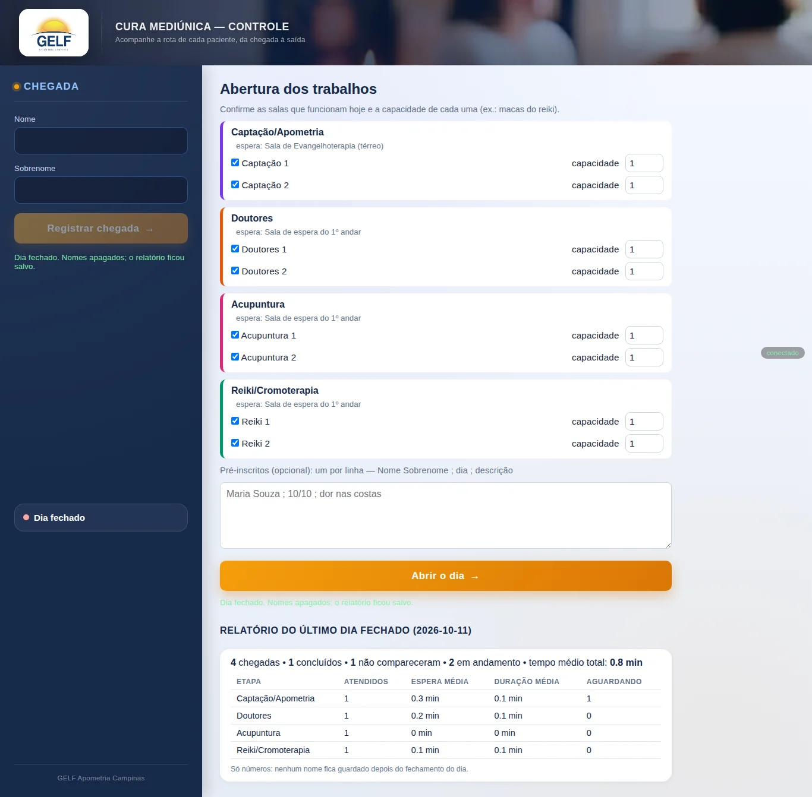

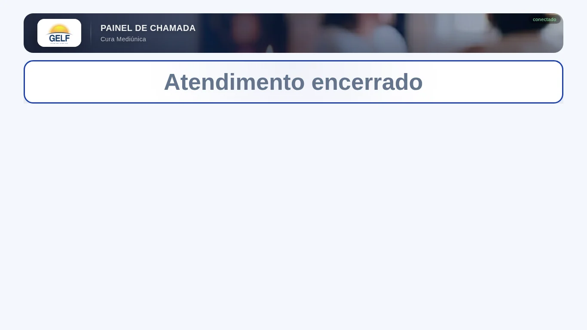

## Transições de um paciente

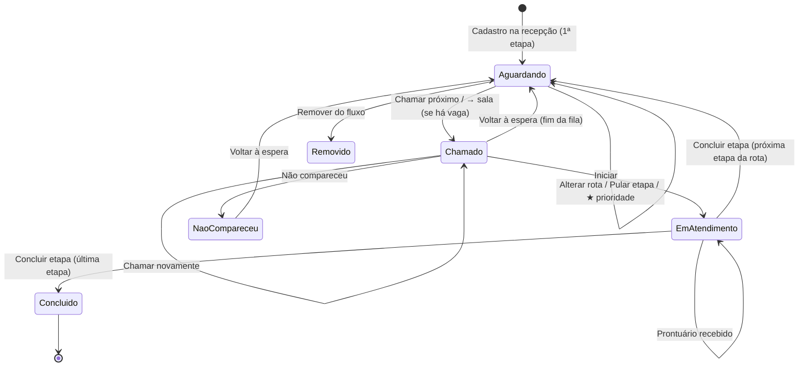

## Transições do prontuário

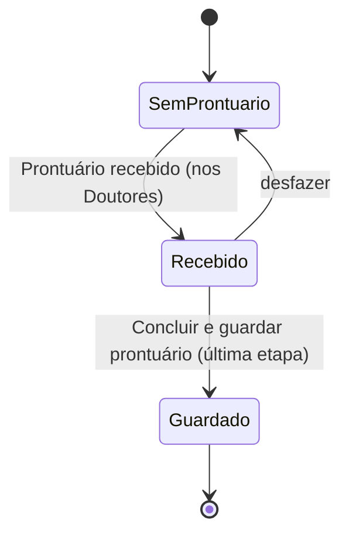

## Transições de uma sala

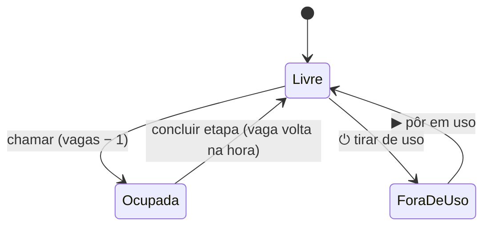

## Pendências conhecidas
- Orientações pós-atendimento do roteiro e tela de sala para celular (a sala avisaria pelo celular que está pronta):
  fases seguintes.
- Som e ajuste à TV Samsung 32" ainda precisam ser conferidos no equipamento real.
- Salas do térreo para os prioritários: hoje o sistema só **avisa** (recepção, controle e TV); definir quais salas de Doutores e Reiki ficam no térreo permitiria indicá-las na chamada.
