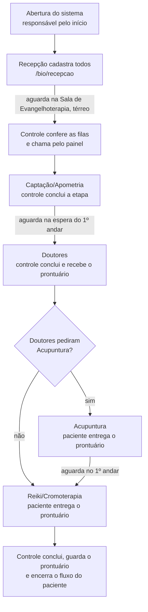

# Fluxo operacional dos tratamentos bioenergéticos

Processo oficial de atendimento, como descrito pela organização, e como o sistema o atende. É a referência
para qualquer ajuste do módulo `/bio`. O passo a passo das telas está no [Fluxo 5 — Cura Mediúnica](5-bio.md).

## O processo em uma página

## Os 18 passos e o que o sistema faz em cada um

| # | Passo oficial | Quem | No sistema |
|---|---|---|---|
| 1 | Abrir o sistema e os módulos do dia | responsável pelo início | **Abrir o dia** em `/bio/controle` (salas, capacidades, pré-inscritos); TVs em `/bio/painel` |
| 2 | Cadastrar todos os pacientes | recepção | `/bio/recepcao`: nome e sobrenome, ou toque no pré-inscrito |
| 3 | Orientar a aguardar na sala de Evangelhoterapia (térreo) | recepção | A tela da recepção mostra a orientação após cada cadastro |
| 4 | Conferir as filas já com todos os cadastrados | controle e orquestração | `/bio/controle`: colunas por etapa, com **Aguardando** |
| 5 | Iniciar a chamada pelo sistema | controle | **Chamar próximo** (ou **→ sala** para escolher quem entra) |
| 6–7 | Captação/Apometria: chamada pelo painel | controle, TV | A TV mostra etapa, nome, sala e toca o sinal |
| 8 | Registrar a conclusão na Captação/Apometria | controle | **Concluir etapa**; a sala fica em preparo até **Sala pronta** |
| 9 | Orientar a ir à sala de espera do 1º andar | TV | A TV mostra "Etapa concluída — aguarde: Sala de espera do 1º andar" |
| 10 | Chamada para a Sala dos Doutores | controle, TV | Igual ao passo 5 |
| 11 | Concluir os Doutores e receber o prontuário | controle | **Concluir etapa** e **Prontuário recebido** (marca que o prontuário está com o paciente) |
| 12 | Orientar o retorno à espera do 1º andar | TV | Igual ao passo 9 |
| 13 | **Acupuntura, só se os doutores pedirem** | controle, TV | **Incluir Acupuntura** no cartão do paciente; o cartão lembra que o paciente entrega o prontuário |
| 14 | Registrar a conclusão da Acupuntura | controle | **Concluir etapa** |
| 15 | Voltar à espera; sem Acupuntura, segue direto ao Reiki/Cromoterapia | controle, TV | A rota padrão já vai dos Doutores ao Reiki/Cromoterapia |
| 16 | Chamada para Reiki/Cromoterapia, levando o prontuário | controle, TV | Igual ao passo 5, com o lembrete no cartão de que o paciente entrega o prontuário |
| 17 | Concluir o Reiki/Cromoterapia e guardar o prontuário | controle | **Concluir e guardar prontuário** |
| 18 | Encerrar o fluxo do paciente no dia | sistema | Ao concluir a última etapa, o paciente fica **Concluído** ("Fluxo concluído" no histórico; "Atendimento concluído" na TV) |

## Regras que o sistema segue

- **Ordem fixa:** Captação/Apometria › Doutores › Acupuntura (opcional) › Reiki/Cromoterapia. Ao incluir a
  Acupuntura, ela entra sempre **antes** do Reiki/Cromoterapia, seja qual for a ordem dos toques.
- **Acupuntura condicional:** a rota padrão não a inclui, então o paciente avança dos Doutores direto ao
  Reiki/Cromoterapia. Só entra quando os doutores pedem (1 vaga).
- **Prontuário:** recebido ao concluir os Doutores; acompanha o paciente; guardado ao concluir a última etapa.
  O controle mostra "📋 Prontuário com o paciente" nos cartões e avisa, ao fechar o dia, se algum ficou sem guardar.
- **Quem registra:** a recepção só cadastra; chamar, concluir e o prontuário são do responsável pelo
  controle e pela orquestração.
- **Fim do fluxo:** o paciente só é dado como encerrado quando todos os tratamentos previstos para ele foram concluídos.

## Nomes das etapas e locais

| Etapa | Sala | Vagas | Espera |
|---|---|---|---|
| Captação/Apometria | Captação 1 e Captação 2 | 1 cada | Sala de Evangelhoterapia (térreo) |
| Doutores | Sala dos doutores | 2 | Sala de espera do 1º andar |
| Acupuntura (opcional) | Sala de acupuntura | 1 | Sala de espera do 1º andar |
| Reiki/Cromoterapia | Sala de reiki | 2 | Sala de espera do 1º andar |

Tudo isso fica em `config/bio.json`.

## Histórico de ajustes feitos a partir deste fluxo
- Acupuntura passou a vir **antes** do Reiki/Cromoterapia (antes ficava depois) e a ser incluída com um toque.
- Criada a tela `/bio/recepcao`: o cadastro deixou de ser feito só no controle.
- Controle do prontuário (recebido, com o paciente, guardado).
- A TV passou a orientar o paciente sobre onde aguardar a próxima etapa.
- Nomes e locais ajustados: Captação/Apometria, Reiki/Cromoterapia, Sala de Evangelhoterapia (térreo).
