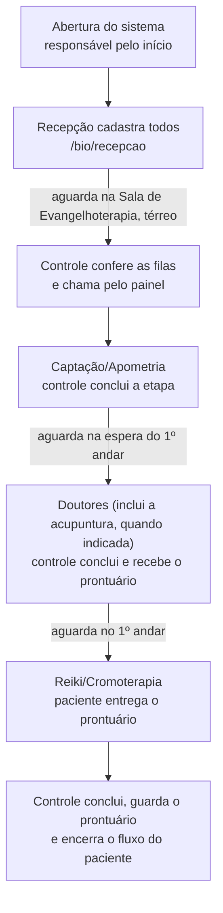

# Fluxo operacional dos tratamentos bioenergéticos

Processo oficial de atendimento, como descrito pela organização, e como o sistema o atende. É a referência
para qualquer ajuste do módulo `/bio`. O passo a passo das telas está no [Fluxo 5 — Cura Mediúnica](5-bio.md).

## O processo em uma página

## Os 18 passos e o que o sistema faz em cada um

| # | Passo oficial | Quem | No sistema |
|---|---|---|---|
| 1 | Abrir o sistema e os módulos do dia | responsável pelo início | **Abrir o dia** em `/bio/controle` (salas, capacidades, pré-inscritos); TVs em `/bio/painel` |
| 2 | Cadastrar todos os pacientes | recepção | `/bio/recepcao`: nome e sobrenome, ou toque no pré-inscrito |
| 3 | Orientar a aguardar na sala de Evangelhoterapia (térreo) | recepção | A tela da recepção mostra a orientação após cada cadastro |
| 4 | Conferir as filas já com todos os cadastrados | controle e orquestração | `/bio/controle`: colunas por etapa, com **Aguardando** |
| 5 | Iniciar a chamada pelo sistema | controle | **Chamar próximo** (ou **→ sala** para escolher quem entra) |
| 6–7 | Captação/Apometria: chamada pelo painel | controle, TV | A TV mostra etapa, nome, sala e toca o sinal |
| 8 | Registrar a conclusão na Captação/Apometria | controle | **Concluir etapa**; a vaga da sala volta na hora, pronta para o próximo |
| 9 | Orientar a ir à sala de espera do 1º andar | TV | A TV mostra "Etapa concluída — aguarde: Sala de espera do 1º andar" |
| 10 | Chamada para os Doutores | controle, TV | Igual ao passo 5 |
| 11 | Concluir os Doutores e receber o prontuário | controle | **Concluir etapa** e **Prontuário recebido** (marca que o prontuário está com o paciente) |
| 12 | Orientar o retorno à espera do 1º andar | TV | Igual ao passo 9 |
| 13–15 | Acupuntura (quando indicada) | doutores | **Faz parte do atendimento dos Doutores**: não é mais uma etapa nem uma sala separada, então não há chamada, conclusão ou espera próprias. O paciente segue dos Doutores direto ao Reiki/Cromoterapia |
| 16 | Chamada para Reiki/Cromoterapia, levando o prontuário | controle, TV | Igual ao passo 5, com o lembrete no cartão de que o paciente entrega o prontuário |
| 17 | Concluir o Reiki/Cromoterapia e guardar o prontuário | controle | **Concluir e guardar prontuário** |
| 18 | Encerrar o fluxo do paciente no dia | sistema | Ao concluir a última etapa, o paciente fica **Concluído** ("Fluxo concluído" no histórico; "Atendimento concluído" na TV) |

## Regras que o sistema segue

- **Ordem fixa:** Captação/Apometria › Doutores › Reiki/Cromoterapia. A ordem vale mesmo que outro cliente envie a rota fora de ordem.
- **Acupuntura:** incorporada ao tratamento com os Doutores (decisão de 24/10/2026); não aparece como etapa nem sala.
- **Prontuário:** recebido ao concluir os Doutores; acompanha o paciente; guardado ao concluir a última etapa.
  O controle mostra "📋 Prontuário com o paciente" nos cartões e avisa, ao fechar o dia, se algum ficou sem guardar.
- **Prioridade:** idosos, gestantes e pessoas com deficiência podem ser marcados com ★ (recepção ou controle). Passam na
  frente em **todas** as esperas da jornada, na ordem em que foram marcados. **Os tratamentos dos prioritários devem ser feitos
  em uma sala do térreo e, entre os atendimentos, eles aguardam na Sala de Evangelhoterapia (térreo) até serem chamados**: o
  sistema avisa isso na recepção, no controle e na TV (o texto fica em `config/bio.json`, campo `prioridade`).
- **Relatório do atendimento:** ao final do dia, o controle gera o registro completo (dados dos pacientes, etapa, sala, horários de
  início e fim, resumo geral) e o salva em **PDF** antes de fechar o dia (`/bio/relatorio`).
- **Sala de destino:** o controle pode informar, em qualquer cartão, a sala para onde o paciente deve ir (texto livre). Ela aparece na
  recepção e na TV no lugar da sala chamada.
- **Progresso na TV:** a TV mostra, para o paciente em destaque e para os últimos chamados, uma barra de progresso por etapas
  (concluída, em atendimento, chamado, aguardando, a fazer).
- **Quem registra:** a recepção só cadastra; chamar, concluir e o prontuário são do responsável pelo
  controle e pela orquestração.
- **Fim do fluxo:** o paciente só é dado como encerrado quando todos os tratamentos previstos para ele foram concluídos.

## Nomes das etapas e locais

Toda etapa tem **duas salas de 1 vaga**, ou seja, **2 atendimentos simultâneos**.

| Etapa | Salas | Atendimentos simultâneos | Espera |
|---|---|---|---|
| Captação/Apometria | Captação 1 e Captação 2 | 2 | Sala de Evangelhoterapia (térreo) |
| Doutores | Doutores 1 e Doutores 2 | 2 | Sala de espera do 1º andar |
| Reiki/Cromoterapia | Reiki 1 e Reiki 2 | 2 | Sala de espera do 1º andar |

Tudo isso fica em `config/bio.json`.

## Histórico de ajustes feitos a partir deste fluxo
- Acupuntura passou a vir **antes** do Reiki/Cromoterapia (antes ficava depois) e a ser incluída com um toque.
- Criada a tela `/bio/recepcao`: o cadastro deixou de ser feito só no controle.
- Controle do prontuário (recebido, com o paciente, guardado).
- A TV passou a orientar o paciente sobre onde aguardar a próxima etapa.
- Nomes e locais ajustados: Captação/Apometria, Reiki/Cromoterapia, Sala de Evangelhoterapia (térreo).
- Retirada a opção **Sala pronta**: a vaga da Captação/Apometria volta assim que a etapa é concluída.
- Todas as etapas passaram a ter 2 atendimentos simultâneos (duas salas de 1 vaga), como a Captação/Apometria.
- 24/10/2026: a Acupuntura foi **incorporada ao tratamento com os Doutores** (saiu como etapa e sala separadas).
- 24/10/2026: criado o **Relatório do atendimento** (`/bio/relatorio`), com dados dos pacientes, horários de início e fim e resumo geral, para salvar em PDF.
- 24/10/2026: prioritários passam a ter aviso de **atendimento em sala do térreo** e de espera na **Sala de Evangelhoterapia (térreo)** entre os atendimentos.
- 24/10/2026: botão **Abrir o dia** movido para o menu da esquerda, abaixo de **Registrar chegada**; correção da barra de rolagem no controle e na recepção.
- 24/10/2026: campo **Sala para onde o paciente deve ir** no controle (exibido na recepção e na TV) e **barra de progresso por etapas** no painel da TV.
