# Painel GELF — Roteiro rápido: Bio Energia

## O passo a passo de um dia de atendimento, do clique no atalho ao fim do dia

## 1. Ligar o sistema

| Computador | Como ligar |
|---|---|
| **Linux Mint** | Duplo clique no ícone **Painel GELF** (Área de Trabalho ou menu). Se o ícone mostrar um aviso, clique com o botão direito e escolha *Permitir execução*. |
| **Windows** | Duplo clique em **INICIAR-SISTEMA.bat** (dentro da pasta do sistema). |

Abre uma **janela escura** (o terminal) com os endereços do sistema. **Não feche essa janela**: ela é o sistema funcionando.
Em poucos segundos o **navegador abre sozinho** na página inicial.

<figure>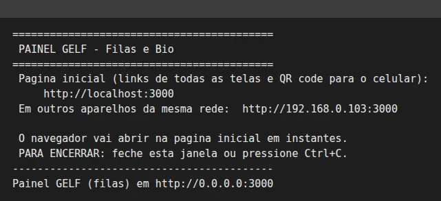<figcaption>A janela do sistema (exemplo). Deixe-a aberta o dia todo.</figcaption></figure>

## 2. A página inicial

Na seção **Tratamentos - Bio Energia** ficam os links das telas e **dois QR codes** da tela usada no celular, o **Controle**:

- **Pelo nome**: use primeiro.
- **Pelo IP**: use se o primeiro não abrir no seu aparelho (acontece em alguns Android e em redes de visitantes).

O celular precisa estar na **mesma rede Wi-Fi** do computador.

<figure>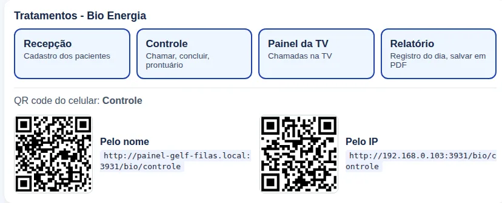<figcaption>Seção Bio Energia da página inicial, com os dois QR codes.</figcaption></figure>

## 3. O responsável abre o dia (Controle)

No **Controle** (`/bio/controle`), em **Abertura dos trabalhos**:

1. Deixe marcadas as **salas** que funcionam hoje e ajuste a **capacidade** de cada uma.
2. Em **sala/local**, informe onde cada tratamento acontece hoje (ex.: *Sala 03 (térreo)*).
3. Se houver lista de **pré-inscritos**, cole no campo, **um por linha**: `Nome Sobrenome ; dia ; descrição`.
4. Toque em **Abrir o dia** (menu da esquerda). O indicador passa a **Dia aberto**.

<figure>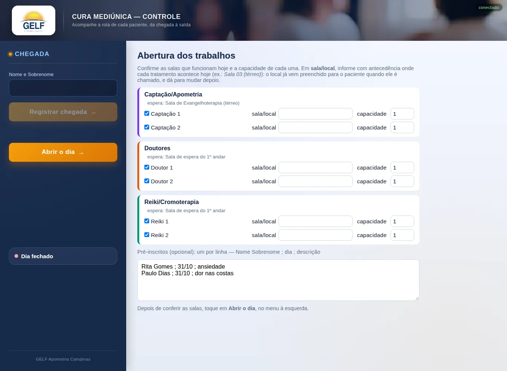<figcaption>Abertura dos trabalhos: salas, capacidades e pré-inscritos. Depois, <b>Abrir o dia</b>.</figcaption></figure>

## 4. A recepção cadastra os pacientes

Na **Recepção** (`/bio/recepcao`), digite **Nome e Sobrenome** (no mesmo campo; pelo menos duas palavras) e toque em **Cadastrar**, ou toque no nome em **Pré-inscritos**.
A tela orienta: *aguardar na Sala de Evangelhoterapia (térreo)*. Use ★ para **prioridade** (idosos, gestantes, pessoas com deficiência).

<figure>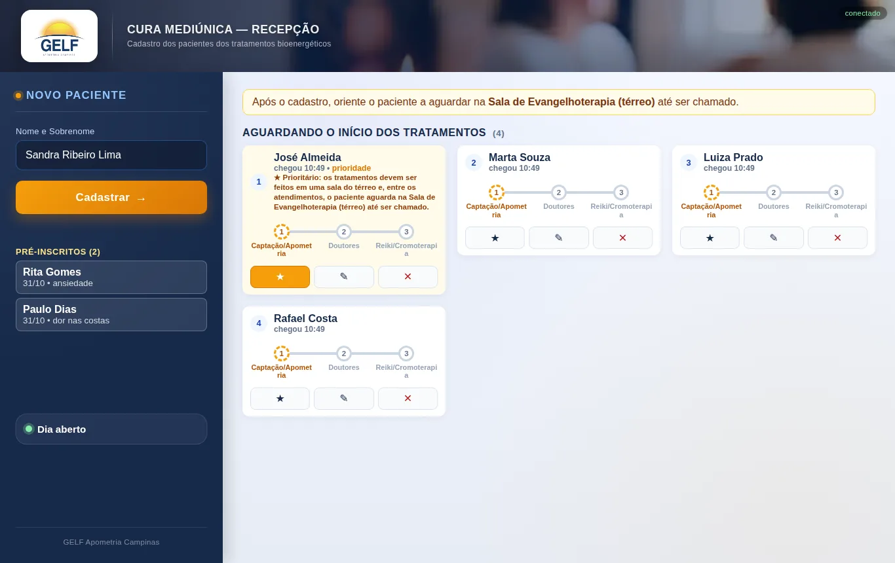<figcaption>Recepção do Bio: cadastro por Nome e Sobrenome, pré-inscritos e a lista de quem aguarda.</figcaption></figure>

## 5. O controle chama para uma sala

Cada etapa é uma coluna (Captação/Apometria, Doutores, Reiki/Cromoterapia), com suas salas e a lista **Aguardando**.
Toque em **Chamar próximo** na sala (os prioritários ★ vêm primeiro) ou em **→ nome da sala**, no cartão do paciente, para escolher quem entra.
Só chama se há vaga. A **TV** mostra o nome, a sala e toca o sinal (na TV, abra o **Painel da TV**, aperte **F11** e toque em **Ativar som** uma vez).

<figure>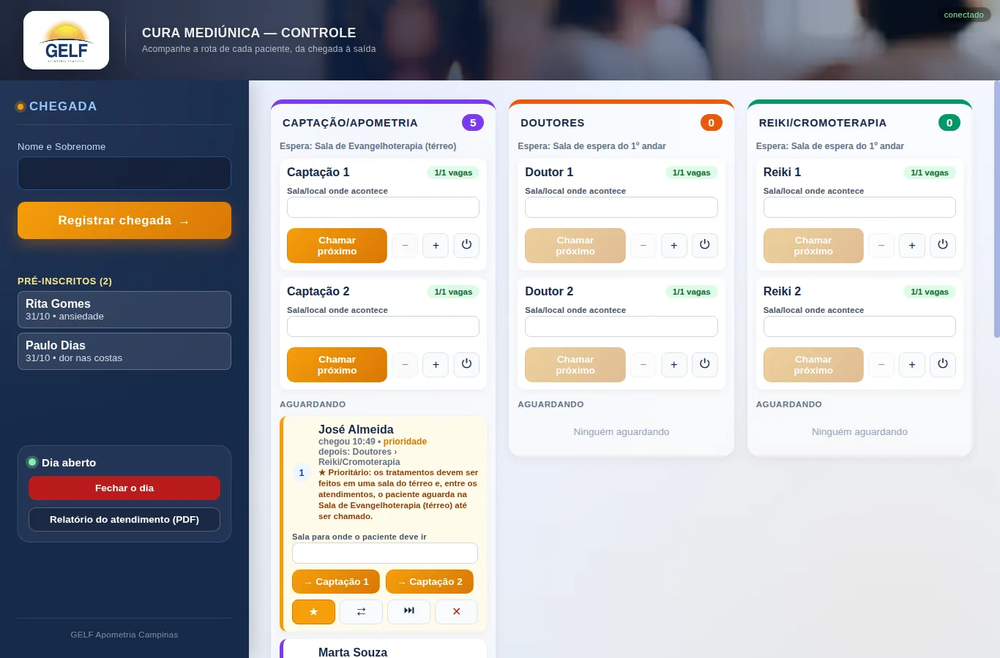<figcaption>Controle: uma coluna por etapa, com salas, vagas e a lista de espera.</figcaption></figure>

<figure><figcaption>Painel da TV com a chamada.</figcaption></figure>

## 6. Iniciar e concluir a etapa

- Paciente chegou à sala: **Iniciar**. Se demorar, **Chamar novamente**; se não vier, **Não compareceu**.
- Terminou a etapa: **Concluir etapa**. A vaga volta na hora e o paciente vai para a espera da próxima etapa; a TV orienta onde aguardar.

<figure>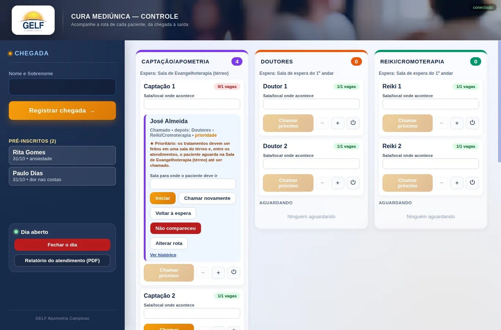<figcaption>Paciente chamado: <b>Iniciar</b>, <b>Chamar novamente</b>, <b>Voltar à espera</b> ou <b>Não compareceu</b>.</figcaption></figure>

<figure>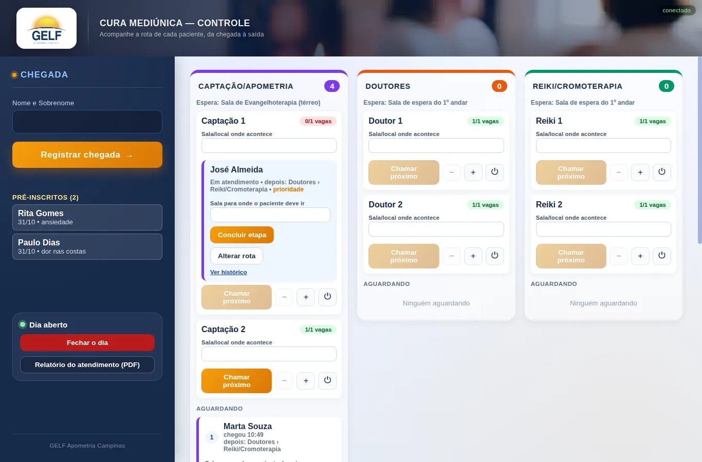<figcaption>Em atendimento: <b>Concluir etapa</b>.</figcaption></figure>

## 7. Doutores: prontuário recebido

No cartão do paciente na sala dos **Doutores**, marque **Prontuário recebido**. O cartão mostra *Prontuário com o paciente* e a sala seguinte lembra que ele deve entregá-lo.

<figure>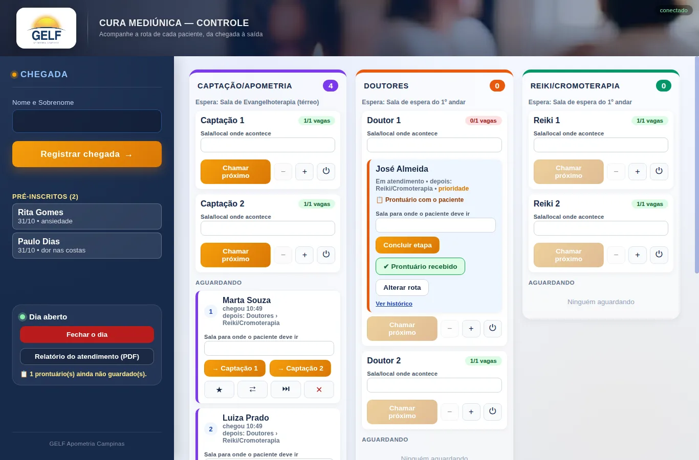<figcaption>Doutores: prontuário recebido.</figcaption></figure>

## 8. Reiki: guardar o prontuário e encerrar

Na última etapa, o botão é **Concluir e guardar prontuário**: conclui a etapa, registra que o prontuário foi guardado e **encerra o fluxo do paciente no dia**.

<figure>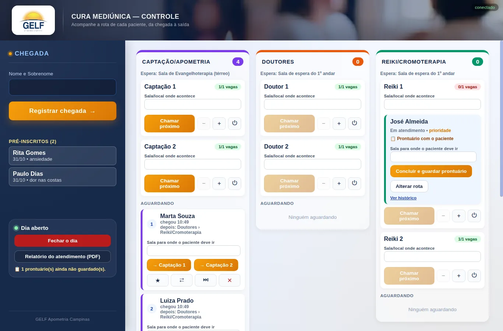<figcaption>Reiki/Cromoterapia: <b>Concluir e guardar prontuário</b>.</figcaption></figure>

## 9. Fim do dia: relatório e fechamento

1. No menu da esquerda, toque em **Relatório do atendimento (PDF)**. Ele traz os dados dos pacientes, a sala, os horários de início e fim de cada tratamento e um resumo geral.
2. Toque em **Salvar em PDF / Imprimir** e, na janela, escolha **Salvar como PDF**.
3. **Só depois** toque em **Fechar o dia** e confirme em **Confirmar: apagar tudo**: os nomes são apagados. Fica salvo apenas o relatório sem nomes.

<figure>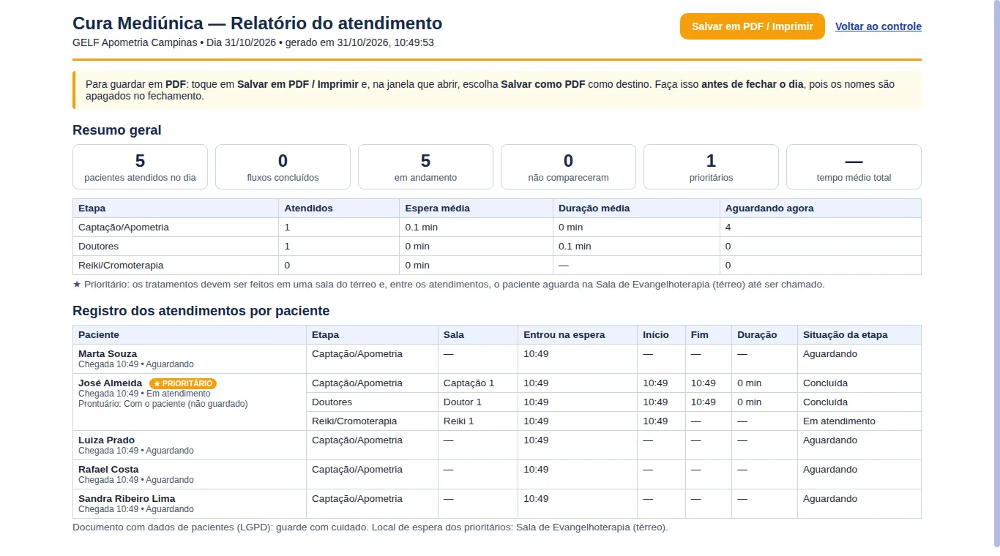<figcaption>Relatório do atendimento, pronto para salvar em PDF.</figcaption></figure>

<figure>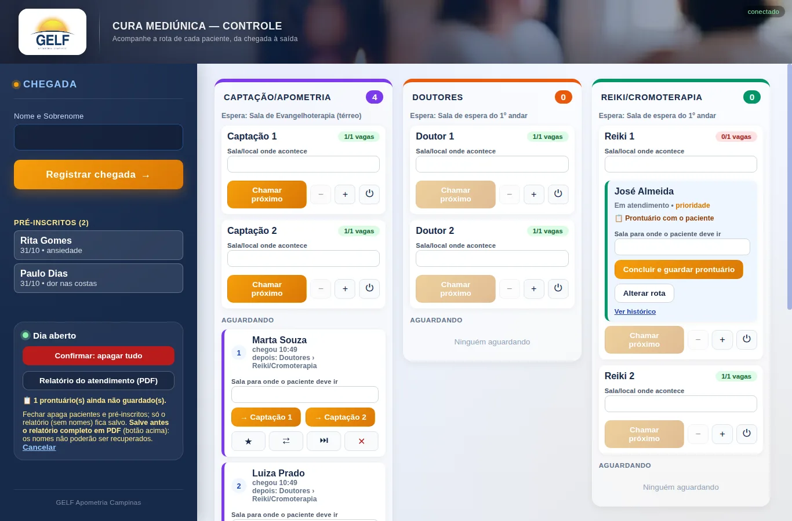<figcaption>Fechar o dia: o botão pede confirmação e lembra de salvar o PDF antes.</figcaption></figure>

## 10. Desligar

Feche a **janela escura**. Os nomes dos pacientes ficam só neste computador (pasta `dados`) e são apagados ao fechar o dia.

## Se algo falhar

| Sintoma | O que fazer |
|---|---|
| O navegador não abriu | Abra você mesmo `http://localhost:3000` |
| A tela do celular diz **sem conexão** | Confira o Wi-Fi e use o QR code **Pelo IP** |
| Sem som na TV | Toque em **Ativar som** e confira o volume |
| A janela escura fechou | Dê duplo clique no atalho de novo: o dia é recuperado |

