# Painel GELF — Roteiro rápido: Evangelho Terapia

## O passo a passo de um dia de atendimento, do clique no atalho ao fim do dia

## 1. Ligar o sistema

| Computador | Como ligar |
|---|---|
| **Linux Mint** | Duplo clique no ícone **Painel GELF** (Área de Trabalho ou menu). Se o ícone mostrar um aviso, clique com o botão direito e escolha *Permitir execução*. |
| **Windows** | Duplo clique em **INICIAR-SISTEMA.bat** (dentro da pasta do sistema). |

Abre uma **janela escura** (o terminal) com os endereços do sistema. **Não feche essa janela**: ela é o sistema funcionando.
Em poucos segundos o **navegador abre sozinho** na página inicial.

<figure><figcaption>A janela do sistema (exemplo). Deixe-a aberta o dia todo.</figcaption></figure>

## 2. A página inicial

Na seção **Tratamentos - Evangelho Terapia** ficam os links das telas e **dois QR codes** da tela usada no celular, o **Atendimento**:

- **Pelo nome**: use primeiro.
- **Pelo IP**: use se o primeiro não abrir no seu aparelho (acontece em alguns Android e em redes de visitantes).

O celular precisa estar na **mesma rede Wi-Fi** do computador.

<figure>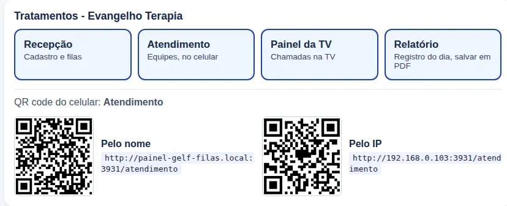<figcaption>Seção Evangelho Terapia da página inicial, com os dois QR codes.</figcaption></figure>

## 3. A recepção abre o atendimento

Abra a **Recepção** (`/recepcao`) e toque em **Abrir atendimento** (canto esquerdo, embaixo). Sem isso ninguém cadastra nem chama.

<figure>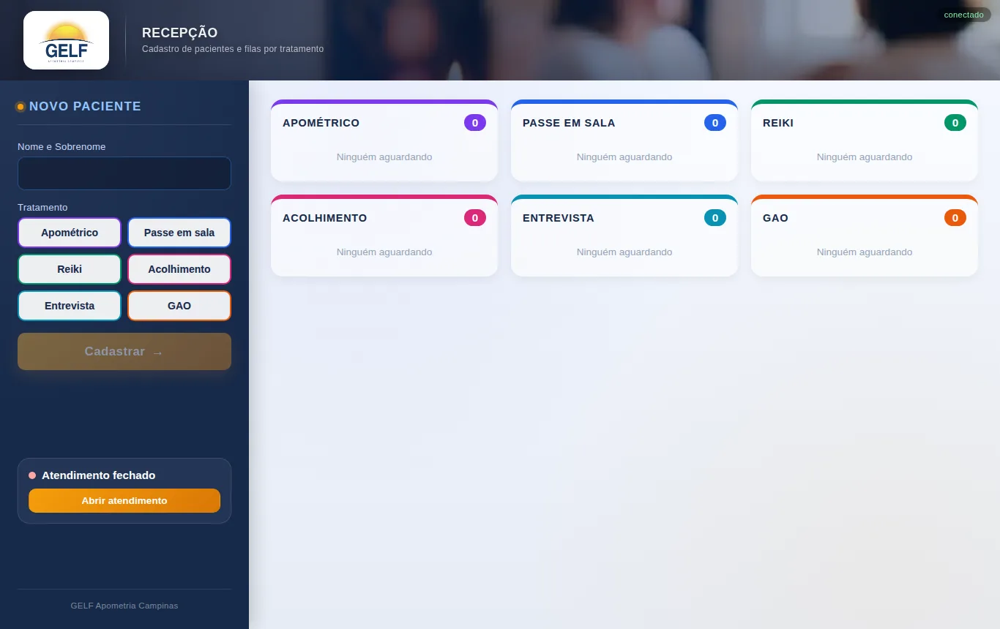<figcaption>Recepção com o atendimento fechado: toque em <b>Abrir atendimento</b>.</figcaption></figure>

## 4. Cadastrar os pacientes

1. Digite **Nome e Sobrenome** (no mesmo campo; pelo menos duas palavras).
2. Toque no **tratamento**.
3. Toque em **Cadastrar**. O paciente entra no fim da fila. Use ★ para dar **prioridade**.

<figure>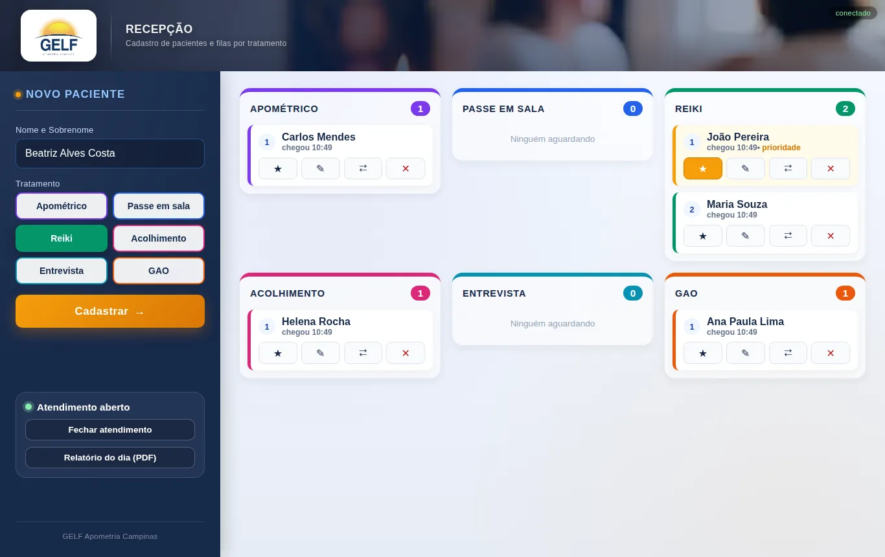<figcaption>Nome e Sobrenome preenchido e o tratamento escolhido.</figcaption></figure>

<figure>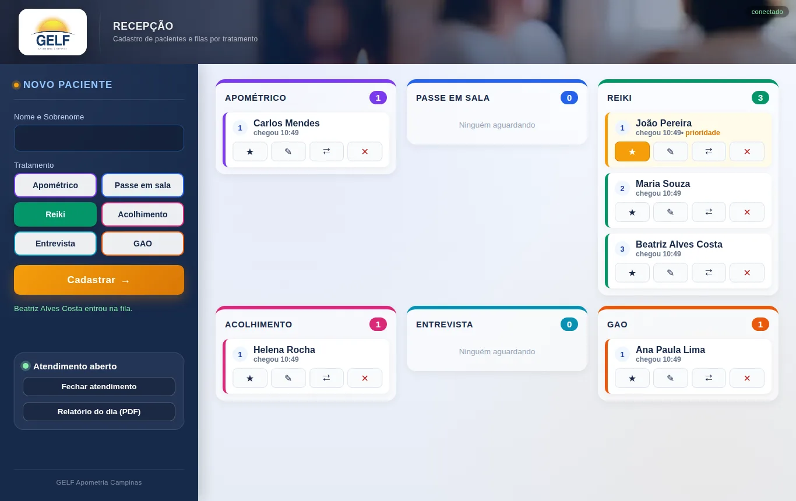<figcaption>Cada tratamento tem a sua fila. O paciente com ★ vai para a frente.</figcaption></figure>

## 5. A equipe chama o paciente, no celular

Aponte a câmera para o QR code do **Atendimento**. Na primeira vez, escolha **o seu tratamento** (o aparelho lembra). Depois toque na **sala** e em **Chamar próximo**.

<figure>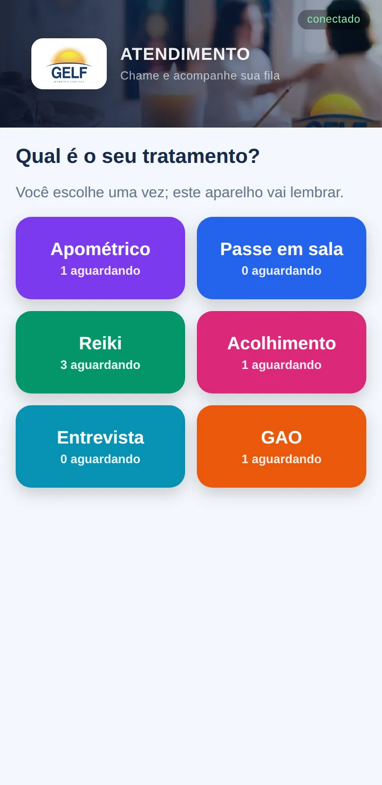<figcaption>Primeira vez: escolher o tratamento.</figcaption></figure><figure>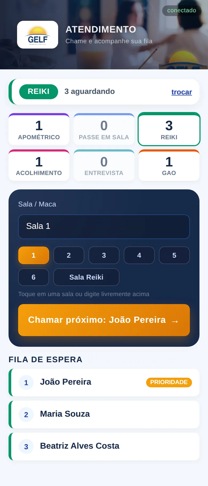<figcaption>Escolher a sala e tocar em <b>Chamar próximo</b>.</figcaption></figure>

## 6. A TV mostra a chamada

A TV mostra o **nome**, a **sala** e toca o **sinal sonoro**. Na TV, abra o **Painel da TV**, aperte **F11** (tela cheia) e toque em **Ativar som** uma vez.

<figure>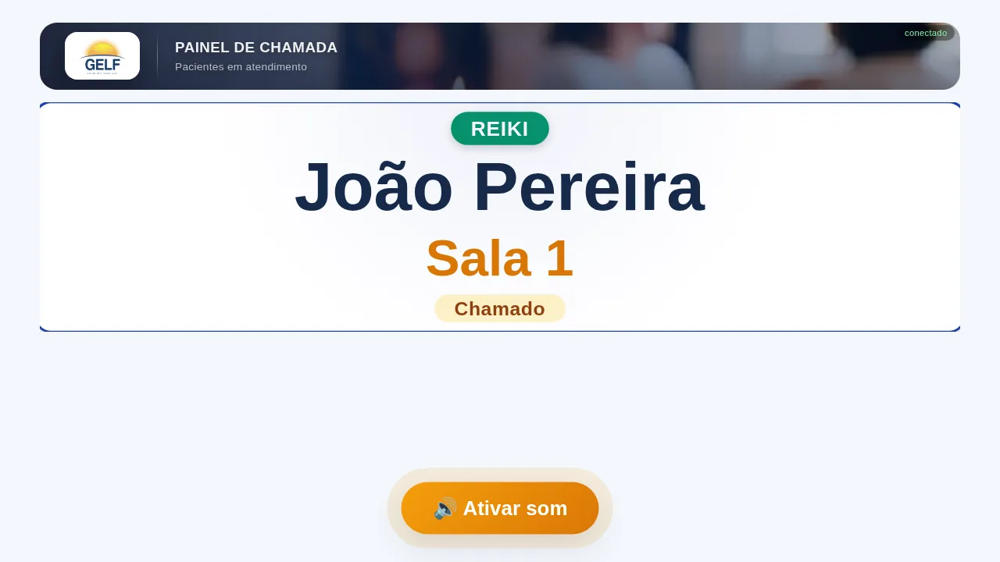<figcaption>Painel da TV com a chamada.</figcaption></figure>

## 7. Iniciar e concluir o atendimento

- Paciente chegou à sala: **Iniciar atendimento**.
- Terminou: **Concluir atendimento**. Em seguida, **Chamar próximo**.
- Não apareceu: **Chamar novamente** e, se ainda assim não vier, **Não compareceu** (toque duas vezes para confirmar).

Cada aparelho atende **um paciente por vez**: conclua antes de chamar outro.

<figure>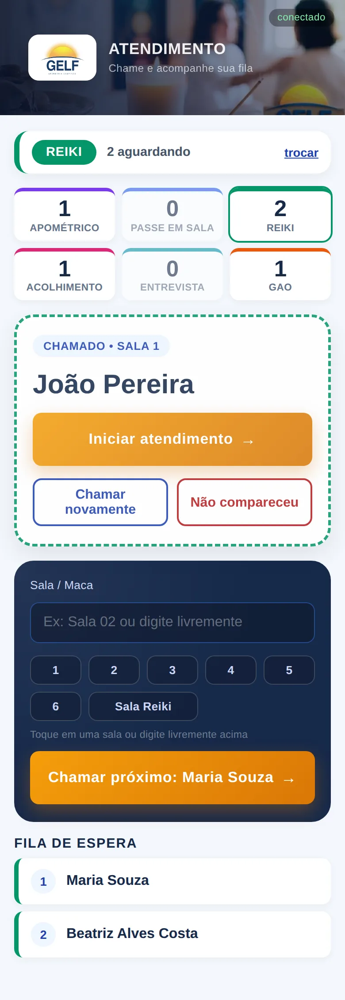<figcaption>Chamado: <b>Iniciar atendimento</b>.</figcaption></figure><figure>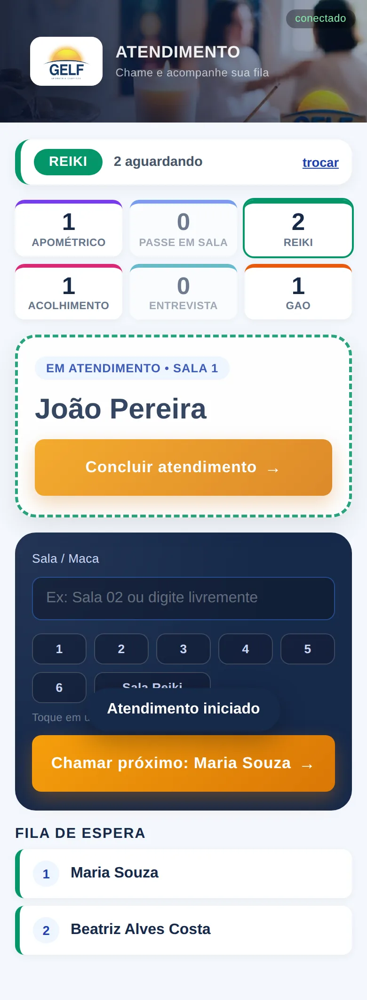<figcaption>Em atendimento: <b>Concluir atendimento</b>.</figcaption></figure><figure>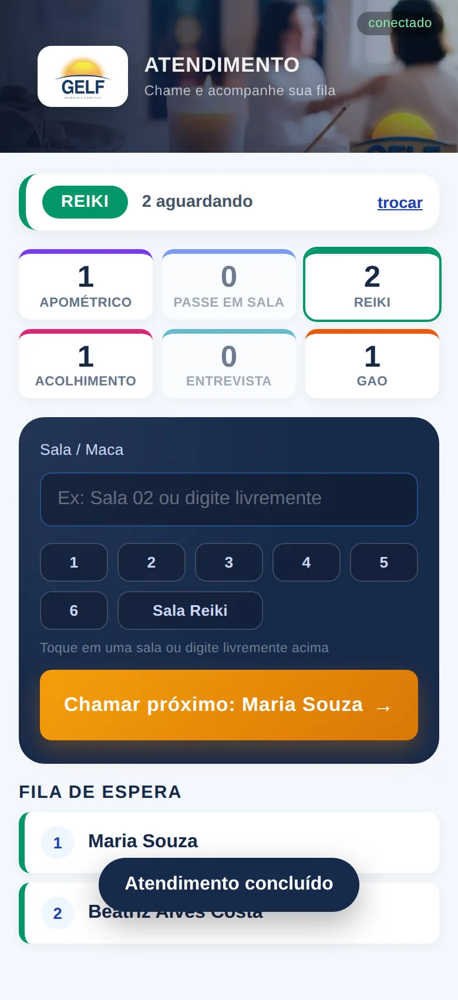<figcaption>Concluído: já dá para chamar o próximo.</figcaption></figure>

## 8. Fim do dia: relatório e fechamento

1. Na Recepção, toque em **Relatório do dia (PDF)**. Ele mostra o resumo por tratamento e o registro de cada paciente (chegada, chamada, sala, início, fim, espera e duração).
2. Toque em **Salvar em PDF / Imprimir** e, na janela, escolha **Salvar como PDF**.
3. **Só depois** toque em **Fechar atendimento** e confirme: os nomes são apagados. Fica salvo apenas o resumo em números.

<figure>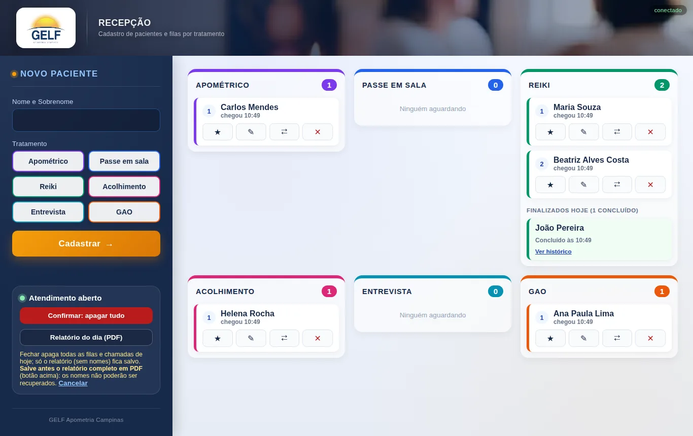<figcaption>Antes de fechar: <b>Relatório do dia (PDF)</b>. O botão de fechar pede uma confirmação.</figcaption></figure>

<figure>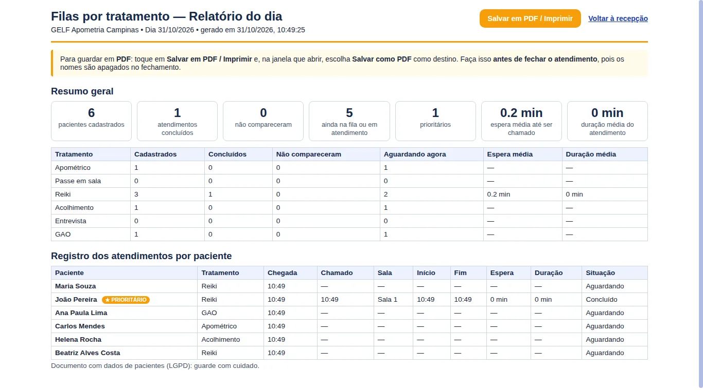<figcaption>Relatório do dia, pronto para salvar em PDF.</figcaption></figure>

## 9. Desligar

Feche a **janela escura**. Os nomes dos pacientes ficam só neste computador (pasta `dados`) e são apagados ao fechar o atendimento.

## Se algo falhar

| Sintoma | O que fazer |
|---|---|
| O navegador não abriu | Abra você mesmo `http://localhost:3000` |
| A tela do celular diz **sem conexão** | Confira o Wi-Fi e use o QR code **Pelo IP** |
| Sem som na TV | Toque em **Ativar som** e confira o volume |
| A janela escura fechou | Dê duplo clique no atalho de novo: o dia é recuperado |

